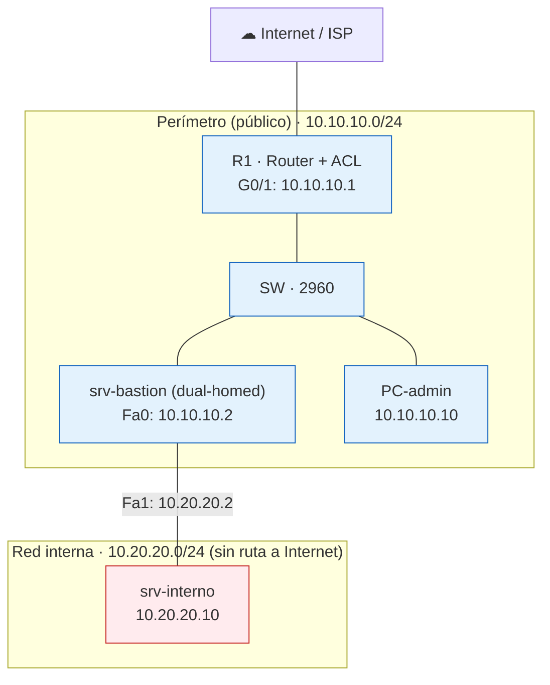
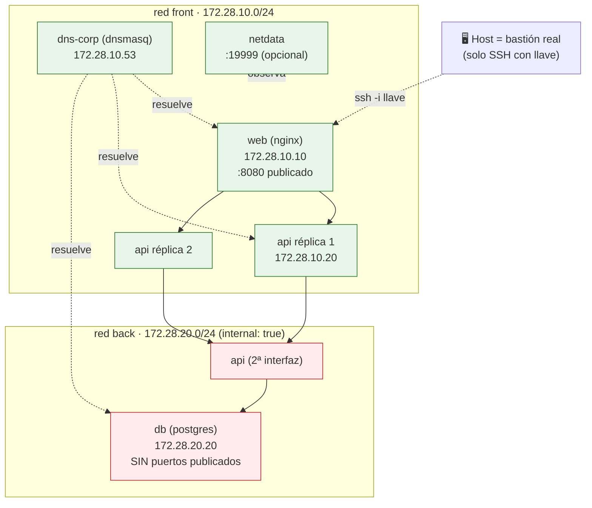
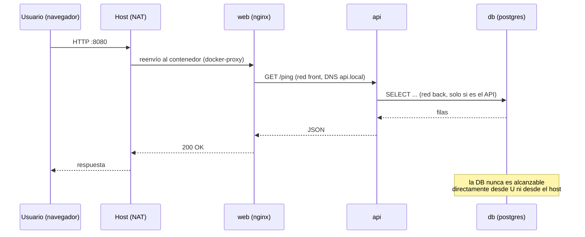
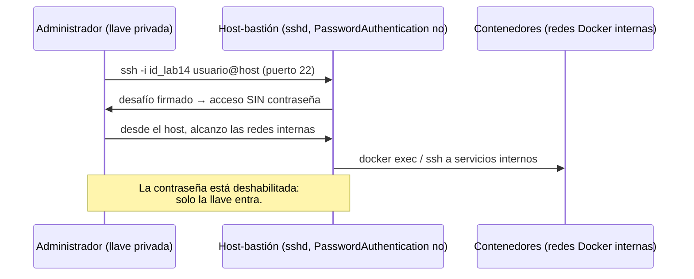
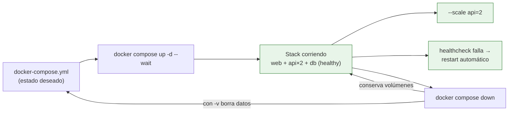
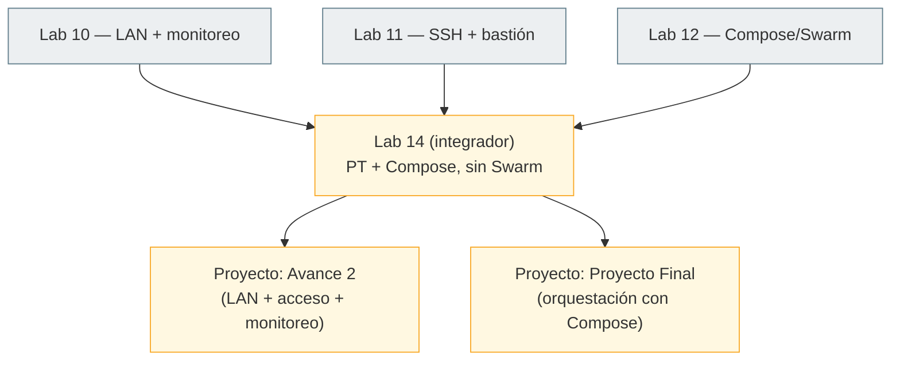

# Diagramas del Laboratorio N.º 14 (Mermaid para draw.io)

Topología de Packet Tracer, arquitectura de Docker Compose y flujos del
laboratorio, listos para insertar en **draw.io**.

## Cómo usarlos en draw.io

1. Abre draw.io (diagram.net) → **Arrange > Insert > Mermaid** (o el botón `+`).
2. Copia el bloque `mermaid` y pégalo en el cuadro de texto.
3. Deja la opción **Diagram** (formas editables) o **Image** (SVG único).
4. Clic en **Insert**.

> Si el parser falla, borra las líneas `classDef`/`class`: son solo estilo.

---

## 1. Topología física — Packet Tracer (el perímetro)

**Lectura:** el bastión es el **único** equipo con pie en las dos redes. No hay
ruta directa PC → srv-interno: hay que pasar por el bastión (doble salto SSH).

---

## 2. Arquitectura del stack — Docker Compose (el data center)

**Lectura:** el API es el único "puente" front↔back. La DB vive **solo** en
`back` (interna) y no publica puertos: es inalcanzable desde el host.

---

## 3. Flujo de un paquete (comparación de lupas)

**En Packet Tracer** este mismo flujo se ve paquete a paquete en **Simulation
mode** (PDU por salto, con ACL evaluada en R1). En Docker se ve con
`tcpdump -i br-front` (la lupa cambia, el paquete es el mismo).

---

## 4. Acceso por SSH al bastión (el host)

---

## 5. Ciclo de vida orquestado (Compose)

---

## 6. Mapa de la asignatura dentro del laboratorio

