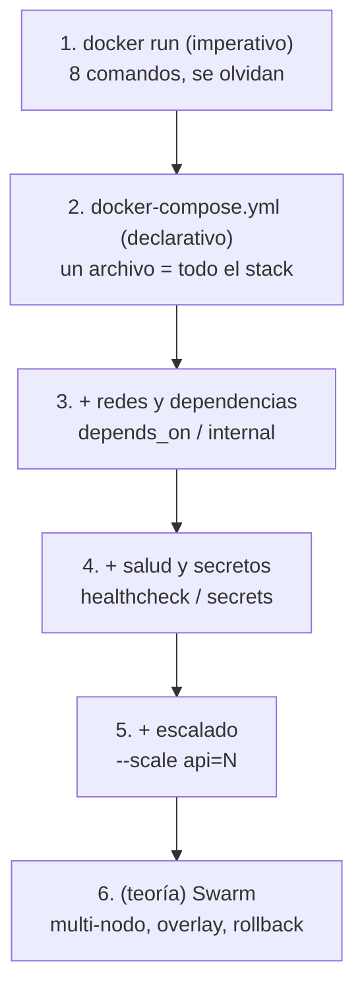

# Refuerzo — Orquestación con Docker Compose

**El eje central del Laboratorio N.º 14.** Las 4 sesiones no son temas sueltos:
todas construyen, paso a paso, el stack que finalmente se **orquesta con un solo
comando**. Este módulo es el entrenamiento focalizado: se hace después de la
Sesión 2 y se repasa antes de la Sesión 4.

> **Idea que hay que dominar:** orquestar es **declarar el estado deseado** y
> dejar que el motor lo **reconcilie** (crear, escalar, reiniciar, respetar
> dependencias). Tú describes *qué* quieres; Compose decide *cómo* lograrlo.

---

## 0. La escalera de la orquestación



Cada peldaño de esta escalera se cubre en el laboratorio. Si dominas los pasos
1→5, ya puedes entregar el Proyecto Final.

---

## Drill 1 — De imperativo a declarativo

**Entrada:** alguien dejó un stack hecho a mano (8 comandos que nadie recuerda).

```bash
docker network create front
docker network create --internal back
docker run -d --name db --network back -e POSTGRES_PASSWORD=secreto postgres:15-alpine
docker run -d --name api --network back -p 8000:8000 python:3.11-slim sleep 3600
docker run -d --name web --network front -p 8080:80 nginx:alpine
docker network connect front api
```

**Tarea:** reescribirlo como `docker-compose.yml` equivalente. Debe cumplir:

- [ ] Redes `front` y `back` (esta última `internal: true`).
- [ ] `web` solo en `front`, con `ports: ["8080:80"]`.
- [ ] `api` en `front` y `back`, con `expose: ["8000"]` (no `ports`).
- [ ] `db` solo en `back`, **sin** puertos publicados.
- [ ] Credenciales **fuera** del YAML (pista: `secrets:`).

**Verificación:** `docker compose up -d --wait` y `docker compose ps` todo
`(healthy)` / `running`.

---

## Drill 2 — Depura un `docker-compose.yml` roto

Este archivo tiene **6 defectos**. Encántralos todos y corrígelos.

```yaml
services:
  web:
    image: nginx:alpine
    ports: ["8080:80"]
    depends_on: [api]
    networks: [front]

  api:
    image: lab14-api
    environment:
      DB_PASSWORD: labpass123        # (1)
    networks: [front, back]

  db:
    image: postgres:15-alpine
    ports: ["5432:5432"]             # (2)
    networks: [back]
    restart: always                  # (3)

networks:
  front: {}
  back:
    internal: false                  # (4)

# (5) falta declarar los secretos
# (6) la API no tiene healthcheck ni la web espera su salud
```

<details>
<summary>Ver solución</summary>

1. **Contraseña en `environment`** → mover a `secrets:` y usar
   `POSTGRES_PASSWORD_FILE: /run/secrets/db_pass`.
2. **DB publica `5432`** → quitar `ports:` (la DB nunca se expone).
3. **`restart: always`** reinicia incluso tras un `stop` manual → usar
   `unless-stopped`.
4. **`internal: false`** deja la red interna con salida → `internal: true`.
5. **Falta el bloque `secrets:`** raíz que declare `db_pass: { file: ./db_pass.txt }`.
6. **Falta `healthcheck`** en la API y la web debe usar
   `depends_on: { api: { condition: service_healthy } }`.

</details>

---

## Drill 3 — Dependencias y salud (el orden importa)

**Problema típico:** la web arranca antes que la API y da 502 durante los
primeros segundos. **Solución:** arranque condicionado a la salud.

```yaml
  web:
    depends_on:
      api:
        condition: service_healthy
  api:
    healthcheck:
      test: ["CMD", "python", "-c",
             "import urllib.request as u;u.urlopen('http://localhost:8000/ping')"]
      interval: 5s
      timeout: 3s
      retries: 5
```

**Comprueba la diferencia:**

```bash
# Sin healthcheck: 'up' termina enseguida, la web puede dar 502
docker compose up -d && sleep 1 && curl -s -o /dev/null -w "%{http_code}\n" localhost:8080

# Con --wait + healthchecks: 'up' no retorna hasta que TODO está sano
docker compose up -d --wait && curl -s -o /dev/null -w "%{http_code}\n" localhost:8080
```

> **Pregunta:** ¿en qué se parece `condition: service_healthy` al orden en que
> subirías, en Packet Tracer, primero el router y después el bastión? *(Respuesta:
> en ambos casos, un servicio no debe probarse hasta que la base esté lista.)*

---

## Drill 4 — Secreto: que no aparezca en el YAML

```bash
printf 'clave-super-secreta' > db_pass.txt

# 1. El secreto existe dentro del contenedor:
docker exec db-srv cat /run/secrets/db_pass

# 2. NO aparece en el YAML:
grep -c "clave-super-secreta" docker-compose.yml     # debe ser 0

# 3. NO aparece en docker inspect:
docker inspect db-srv | grep -i "clave-super-secreta" || echo "bien: no está expuesto"
```

**Regla de oro:** si `grep` encuentra la credencial en el repositorio, el criterio
de secretos vale **0**.

> *Nota avanzada (Swarm, solo teoría):* en un clúster el secreto se cifra en
> tránsito y en reposo (raft), y se monta solo en los nodos que lo necesitan.
> Compose lo aproxima con el archivo; el principio es el mismo.

---

## Drill 5 — Escalado y balanceo

```bash
docker compose up -d --scale api=2
docker compose ps api

# Compose registra las réplicas en el DNS embebido
docker compose exec web nslookup api. 127.0.0.11

# Comprueba el reparto (round-robin de nombres)
for i in 1 2 3 4; do docker compose exec -T web getent hosts api | head -1; done
```

**Concepto honesto:** Compose balancea **por DNS**, no con un proxy. Swarm sí
tiene ingress mesh (un puerto publicado reparte entre tareas). Compose es
suficiente para el Proyecto Final; SWARM es la charla de "qué sigue".

---

## Drill 6 — Ciclo de vida y recuperación

| Comando | Qué hace | ¿Conserva datos? |
|---------|----------|:----------------:|
| `docker compose stop` / `start` | Pausa/retoma contenedores | ✅ |
| `docker compose restart api` | Reinicia un servicio | ✅ |
| `docker compose down` | Apaga y borra contenedores/redes | ✅ (volúmenes) |
| `docker compose down -v` | Igual + borra volúmenes | ❌ |
| `docker compose up -d --wait` | Recrea el estado deseado | ✅ |
| `docker inspect <ctr> \| grep RestartPolicy` | Ver política | — |

**Reto de auto-recuperación:** con `restart: unless-stopped`, mata el proceso
interno y observa cómo Compose lo levanta solo:

```bash
docker exec api-srv pkill -f app.py
sleep 6
docker compose ps api    # vuelve a (healthy) sin que tú hagas nada
```

---

## Tabla de troubleshooting de orquestación

| Síntoma | Causa | Arreglo |
|---------|-------|---------|
| `up` retorna antes de estar listo | falta `--wait` | `up -d --wait` |
| Web da 502 al inicio | `depends_on` sin `condition` | `condition: service_healthy` |
| El secreto se ve en `inspect` | se usó `environment:` | migrar a `secrets:` |
| `front` alcanza la DB | DB publica `ports:` | quitar `ports:` |
| La red interna sale a Internet | `internal: false` | `internal: true` |
| Reaparece tras `stop` | `restart: always` | `unless-stopped` |
| Se pierden los datos en cada `down` | se usa `down -v` | usar `down` sin `-v` |
| `--scale` da error de IP | `ipv4_address` fija | quitar IP fija del servicio escalado |

---

## Reto final (evaluativo)

Construye, en una sola carpeta, un stack que cumpla **las 10 condiciones** del
Proyecto Final usando solo Compose:

- [ ] 3+ servicios (front, back, db) en redes separadas.
- [ ] DB interna sin puertos publicados.
- [ ] Credenciales solo por `secrets:`.
- [ ] `healthcheck` en al menos web y api.
- [ ] `depends_on` condicionado a salud.
- [ ] Front y back escalados a ≥2 réplicas.
- [ ] DNS interno resolviendo los nombres.
- [ ] `restart: unless-stopped` en todos.
- [ ] `docker compose up -d --wait` levanta todo desde cero.
- [ ] README con los pasos de despliegue.

**Entrega:** el `docker-compose.yml` + captura de `docker compose ps` con todo
`(healthy)` + `nslookup` de un servicio mostrando las réplicas.

---

## Autoevaluación

- [ ] Puedo convertir un `docker run` de 8 líneas en un Compose.
- [ ] Sé detectar los 6 defectos del Drill 2 sin mirar la solución.
- [ ] Entiendo por qué el orden de arranque depende de la salud.
- [ ] Sé dónde vive un secreto y por qué no debe estar en el YAML.
- [ ] Sé escalar y explicar que el balanceo de Compose es por DNS.
- [ ] Puedo diferenciar `down` de `down -v`.
- [ ] Sé qué añade Swarm (multi-nodo, overlay, rolling update).
