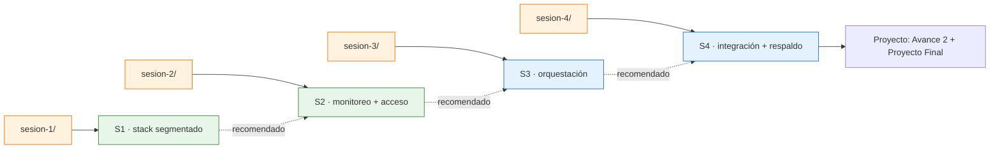

# Reparto de sesiones — Laboratorio N.º 14

Cómo se distribuye el laboratorio en **4 clases** (2 por semana, 120 min cada
una), en las **semanas 10-11**.

El laboratorio tiene **dos pistas independientes**:

- **Pista A — Docker Compose** (obligatoria, 100 pts): las 4 sesiones de abajo.
- **Pista B — Packet Tracer** (opcional, aparte): [PACKET-TRACER.md](PACKET-TRACER.md).

> **Hilo conductor:** la red es el tema, Compose es el medio. Cada sesión de la
> pista A *agrega un piso* a la misma escalera: declarar → operar → orquestar →
> integrar. **Ninguna sesión depende de la pista B.**

---

## 1. Panorama (vista rápida)

| Sesión | Semana / Clase | Foco de RED | En Compose | Punto de partida | Entregable | Pts |
|:------:|:--------------:|-------------|------------|------------------|-----------|:---:|
| **1** | Sem 10 · Clase 1 | Segmentación, subredes, DNS, puertos vs NAT | Primer `docker compose up` + `front`/`back` | [`sesion-1/`](sesion-1/README.md) | Compose + pruebas + `nslookup` | 25 |
| **2** | Sem 10 · Clase 2 | Monitoreo (ancho de banda, latencia) y acceso seguro | Verificación + monitoreo | [`sesion-2/`](sesion-2/README.md) | `tcpdump`/netdata + SSH por llave | 25 |
| **3** | Sem 11 · Clase 1 | Descubrimiento de servicios, balanceo, aislamiento | Orquestación: réplicas, secretos, healthchecks | [`sesion-3/`](sesion-3/README.md) | `compose` + `--scale api=2` + secreto | 25 |
| **4** | Sem 11 · Clase 2 | Red en operación: disponibilidad y diagnóstico | `up --wait`, self-healing, respaldo | [`sesion-4/`](sesion-4/README.md) | Reproducible + dump/restore + demo | 25 |
| | | | | | **Total** | **100** |

> **Cualquier sesión se puede hacer sola.** Cada sesión tiene su carpeta con los
> archivos Docker listos ([`sesion-1/`](sesion-1/README.md) ·
> [`sesion-2/`](sesion-2/README.md) · [`sesion-3/`](sesion-3/README.md) ·
> [`sesion-4/`](sesion-4/README.md)), así que no hace falta haber hecho la
> anterior.

---

## 2. Calendario de las 2 semanas

```
SEMANA 10 (Oct 19-23)                    SEMANA 11 (Oct 26-30)
┌───────────────────────────┐            ┌───────────────────────────┐
│ Clase 1 · Sesión 1        │            │ Clase 1 · Sesión 3        │
│  Primer Compose +         │            │  Orquestación: réplicas,  │
│  segmentación + DNS       │  ──────►   │  secretos, healthchecks   │
│                           │            │  (+ Swarm: solo teoría)   │
├───────────────────────────┤            ├───────────────────────────┤
│ Clase 2 · Sesión 2        │            │ Clase 2 · Sesión 4        │
│  Monitoreo + acceso SSH   │            │  Integración, respaldo    │
│                           │            │  y demo final             │
└───────────────────────────┘            └───────────────────────────┘
        │                                          ▲
        └──── el stack de S1/S2 se orquesta en S3 ─┘
```

---

## 3. Detalle por sesión

### Sesión 1 — Primer stack con Compose + segmentación (120 min)

| Min | Bloque | Qué se hace |
|----:|--------|-------------|
| 0-10 | Encuadre | Es un curso de redes; Compose es el medio (tabla de anclaje) |
| 10-35 | **Bloque 1.1** · Primer `up` | `docker compose up` de web/api/db en una red |
| 35-50 | **Bloque 1.2** · El problema | Red plana: la web alcanza la DB |
| 50-90 | **Bloque 1.3** · Segmentar | Refactor a `front`/`back` + `internal` + DNS; pruebas |
| 90-105 | **Bloque 1.4** · Puente | Tabla de correspondencias (red física ↔ Docker) |
| 105-120 | Cierre | Preguntas 1-4 |

**Entrega:** `docker-compose.yml` con `front`/`back`, pruebas `web↛db`/`api→db` y
`nslookup` de los 3 nombres.

### Sesión 2 — Monitoreo y acceso seguro (120 min)

| Min | Bloque | Qué se hace |
|----:|--------|-------------|
| 0-10 | Repaso | `docker compose ps` + pruebas de segmentación |
| 10-55 | **Bloque 2.1** · Monitorear | `tcpdump`, `iftop`, netdata (métricas de red) |
| 55-95 | **Bloque 2.2** · Acceso | SSH por llave al host; deshabilitar password |
| 95-110 | **Bloque 2.3** · Discusión | Seguridad de acceso: qué exponer y qué no |
| 110-120 | Cierre | Preguntas 1-4 |

**Entrega:** capturas de monitoreo + SSH sin contraseña (y rechazo de password).

### Sesión 3 — Orquestación con Compose (120 min)

| Min | Bloque | Qué se hace |
|----:|--------|-------------|
| 0-15 | Concepto | Orquestar = estado deseado; tabla Compose vs `docker run` |
| 15-50 | **Bloque 3.1** · Completar | Redes, `secrets`, `healthchecks`, `depends_on` |
| 50-75 | **Bloque 3.2** · Arranque | `up --wait` → todo `(healthy)` |
| 75-95 | **Bloque 3.3** · Escalar | `--scale api=2` + balanceo por DNS |
| 95-110 | **Bloque 3.4** · Secretos | `/run/secrets` + `grep` limpio |
| 110-120 | Cierre | **Swarm solo teoría** (5 min) + preguntas 1-4 |

**Entrega:** `docker-compose.yml` completo + `--scale api=2` + secreto + healthchecks.

### Sesión 4 — Integración, respaldo y demo (120 min)

| Min | Bloque | Qué se hace |
|----:|--------|-------------|
| 0-20 | **Bloque 4.1** · Reproducir | `down -v` + `up --wait` desde cero |
| 20-55 | **Bloque 4.2** · Respaldo | `pg_dump` + simular desastre + restaurar |
| 55-75 | **Bloque 4.3** · Self-healing | Matar el proceso del API; Compose lo levanta |
| 75-110 | **Bloque 4.4** · Demo | Presentación del stack (Docker), 10 min/equipo |
| 110-120 | Cierre | Checklist del Proyecto Semestral |

**Entrega:** `docker compose ps` todo `(healthy)` + dump/restore + demo.

---

## 4. Independencia y continuidad

El **camino recomendado** sigue el orden 1 → 2 → 3 → 4, pero cada sesión tiene
un **punto de partida** que permite hacerla de forma aislada:



> **Pista B (Packet Tracer):** totalmente desacoplada. No aparece en ninguna
> sesión de esta tabla porque **no influye** en ellas ni en su nota.

---

## 5. Balance de carga

| Sesión | Contenido nuevo | Práctica | Carga |
|:------:|-----------------|----------|:-----:|
| 1 | Alto (Compose + segmentación + DNS) | Alta | ⚠️ Densa: empezar puntual |
| 2 | Medio (monitoreo + acceso) | Alta | Normal |
| 3 | Alto (orquestación) | Media | Densa pero enfocada |
| 4 | Bajo (consolidación) | Alta (demo) | Normal |

**Recomendaciones:**

- Si la Sesión 1 se atrasa, **recortar** el bloque 1.4 (puente conceptual; dejarlo
  como lectura); nunca recortar la segmentación (es el corazón de la sesión).
- Si la Sesión 3 se atrasa, **recortar** la teoría de Swarm (dejarla como
  lectura); nunca recortar secretos ni healthchecks.
- Los drills de [REFUERZO-ORQUESTACION.md](REFUERZO-ORQUESTACION.md) que no
  entren en clase quedan como **trabajo autónomo** antes de la Sesión 4.

---

## 6. Material por sesión

| Sesión | Guía del estudiante | Apoyo | Docente |
|:------:|---------------------|-------|---------|
| 1 | [SESION-1.md](SESION-1.md) | [TEORIA.md](TEORIA.md) §1,3 | [GUIA-DOCENTE §S1](DOCENTE/GUIA-DOCENTE.md) |
| 2 | [SESION-2.md](SESION-2.md) | [TEORIA.md](TEORIA.md) §2,4 | [GUIA-DOCENTE §S2](DOCENTE/GUIA-DOCENTE.md) |
| 3 | [SESION-3.md](SESION-3.md) | [REFUERZO-ORQUESTACION.md](REFUERZO-ORQUESTACION.md) · [TEORIA.md](TEORIA.md) §5 | [GUIA-DOCENTE §S3](DOCENTE/GUIA-DOCENTE.md) |
| 4 | [SESION-4.md](SESION-4.md) | [EVALUACION.md](EVALUACION.md) checklist | [GUIA-DOCENTE §S4](DOCENTE/GUIA-DOCENTE.md) |

**Material de la pista B (opcional):** [PACKET-TRACER.md](PACKET-TRACER.md).
**Archivos Docker por sesión:** [`sesion-1/`](sesion-1/README.md) ·
[`sesion-2/`](sesion-2/README.md) · [`sesion-3/`](sesion-3/README.md) ·
[`sesion-4/`](sesion-4/README.md).
**Todo lo demás:** [README.md](README.md) · [GUIA-ESTUDIO.md](GUIA-ESTUDIO.md) ·
[DIAGRAMAS.md](DIAGRAMAS.md) · [DOCENTE/SOLUCIONES.md](DOCENTE/SOLUCIONES.md).
