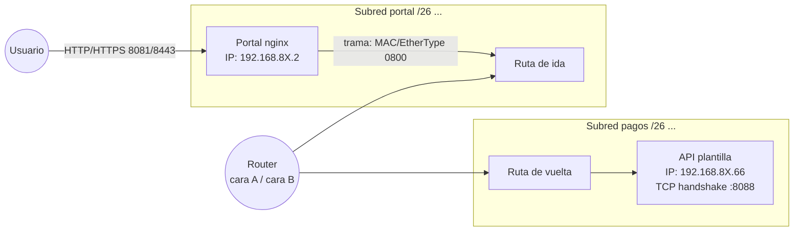

# Diagramas de los casos

**Cada caso se entrega con su diagrama** (incluido en el documento del equipo).
El diagrama NO es decorativo: es la síntesis de lo que se aprendió de la Unidad 1
(capas de red) y se evalúa como criterio propio (15 pts por caso).

## Qué debe tener el diagrama en cada caso

### Caso 1 — una subred

- Rectángulo `portal` con su subred (`/26`), gateway y rango.
- El servicio nginx con su IP y puertos host (8081/8443).
- El DNS con su IP dentro de la red (o al lado) y el nombre resuelto.
- Un recuadro de la *trama* simplificado: MAC origen/destino + EtherType entre el cliente y el portal (teoría del enlace).

### Caso 2 — dos subredes + router

- Todo lo del Caso 1, **más** la subred `pagos` (`/26`) con la API (8088).
- El **router** con sus dos caras (IP por subred) entre ambas.
- Las **rutas** dibujadas (idas y vuelta) y el flujo del "pedido" por ellas.
- Una anotación con el handshake TCP (SYN→SYN-ACK→ACK) en el detalle del transporte.

### Caso 3 — VLSM, el ecosistema completo

- Las **4+ subredes** VLSM de tu escenario (pagos/portal/datos/admin) cada una con su gama IP, broadcast y gateway.
- El router multi-cara y las rutas necesarias.
- La **DB aislada** sin conexión al host (tachá/omití el puerto hacia afuera) y su cara privada desde la API.
- DNS interno (los 3 nombres).
- El **flujo del pedido de tu escenario** (ej. pago de la consulta, del flete...) con las capas etiquetadas: navegador → HTTP → TCP → IP → trama → router → API → Postgres.
- Una leyenda de puertos y protocolos.

## Herramientas permitidas

- **diagrams.net / draw.io** (gratis, web o desktop) — la recomendada.
- **Excalidraw** — bocetos rápidos.
- **Mermaid** (en un `.md`) — si al equipo le resulta más rápido replicar.
- *No* fotos de pantalla sola: el diagrama debe ser construido, no una captura.

## Plantilla Mermaid genérica (Casos 2-3)

Reemplaza las IPs y nombres por los de **tu escenario**. En el Caso 1 usás solo
una subred (o un diagrama de paquetes, no de red).

> En el Caso 3 agregá las subredes `datos` y `admin`, la DB aislada (sin `-p`),
> el DNS interno con los 3 nombres y el flet/transacción del pendiente.

## Errores comunes que se penalizan

- Diagramar IPs **que no coinciden** con las capturas entregadas.
- Olvidar el **enlace/`/30`** o el **broadcast/gateway** en el VLSM.
- No mostrar el **flujo del dato** (un diagrama de red sin flechas de flujo no alcanza).
- Poner la DB "conectada al host" o con puerto publicado, contradiciendo el aislamiento del Caso 3.